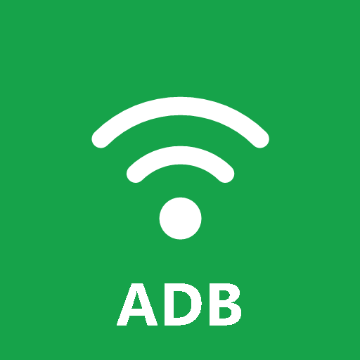

<h1 align="center">adb-autolink</h1>

<p align="center"><b>ADB sans fil sans aucune intervention pour les développeurs Android, conçu pour Claude Code.</b></p>

<p align="center">

[English](README.md) · [한국어](README.ko.md) · [日本語](README.ja.md) · [简体中文](README.zh-Hans.md) · [Español](README.es.md) · **Français**

</p>

<p align="center">
  
</p>

---

Sortez avec votre téléphone, revenez, et demandez simplement à Claude :

> "Installe Builds/game.apk sur mon S21, lance-le et fais une capture d'écran."

Pas de nouvel appairage, pas d'adresse IP, de port ni de code d'appairage à saisir. Le téléphone réactive tout seul le débogage sans fil dès qu'il rejoint un réseau Wi-Fi de confiance, et le serveur MCP le trouve via mDNS et se reconnecte à la demande.

## Fonctionnement

```
 Phone (ADB Autolink app)                      PC (Claude Code + adb-autolink MCP)
 ─────────────────────────                     ───────────────────────────────────
 joins a whitelisted Wi-Fi                     Claude calls any tool (e.g. screenshot)
   → writes adb_wifi_enabled=1                   → adb mdns services  (_adb-tls-connect._tcp)
   → adbd advertises a new random port  ────▶    → adb connect ip:port  (already paired)
                                                 → runs the command
```

- L'appairage est permanent ; ce qui casse en quittant le réseau, c'est uniquement que **le débogage sans fil se désactive** et que **le port change**. Ce projet corrige précisément ces deux points.
- L'application compagnon utilise `WRITE_SECURE_SETTINGS` (accordé une seule fois via adb) pour activer ou désactiver le débogage sans fil. Pas besoin de root.

## Composants

| Chemin | Description |
|---|---|
| `android-app/` | Application compagnon **ADB Autolink** (Kotlin, Compose, Android 11+). Active automatiquement le débogage sans fil sur les SSID de la liste blanche, avec une tuile des Réglages rapides, et survit aux redémarrages. |
| `mcp-server/` | Serveur MCP (TypeScript, bundle autonome précompilé dans `mcp-server/dist`, sans `npm install`) + CLI `adb-autolink`. |
| `skills/setup/` | Skill de configuration guidée pour la première utilisation (`/adb-autolink:setup`). |

## Prérequis

- Claude Code
- Node.js 20+
- Android SDK platform-tools (`adb` 34+ avec mDNS). Détecté via `ADB_PATH`, `ANDROID_HOME` / `ANDROID_SDK_ROOT`, l'emplacement par défaut du SDK d'Android Studio, ou `PATH`.
- Téléphone Android 11+, sur le même LAN que le PC. Cible testée : Samsung Galaxy (One UI).

## Installation

```text
/plugin marketplace add SeokpilYoon/adb-autolink
/plugin install adb-autolink@adb-autolink
```

Redémarrez Claude Code, puis lancez :

```text
/adb-autolink:setup
```

Claude vous guide pour l'appairage et installe l'application compagnon (téléchargée depuis la dernière release GitHub). L'installation accorde via adb toutes les autorisations et exemptions et, en connexion sans fil, autorise le Wi-Fi actuel : il n'y a rien à configurer dans l'application. Il ne reste que l'invite Android *« Toujours autoriser sur ce réseau »*.

Première fois avec le débogage sans fil ? Le [guide illustré](docs/guide/wireless-debugging.fr.md) montre chaque écran avec l'élément à toucher mis en évidence.

### Configuration manuelle (alternative)

1. Appairez une fois : **Options pour les développeurs > Débogage sans fil > Associer l'appareil avec un code d'association**, puis `adb pair <ip:port> <code>` (ou demandez à Claude d'appeler `pair_device`).
2. Installez l'APK depuis les [Releases](https://github.com/SeokpilYoon/adb-autolink/releases/latest) et accordez la permission :
   ```bash
   adb install -r adb-autolink.apk
   adb shell pm grant dev.adbautolink.companion android.permission.WRITE_SECURE_SETTINGS
   ```
3. Dans l'application **ADB Autolink** :
   - Localisation → **Toujours autoriser** et services de localisation activés (nécessaire pour lire le nom du Wi-Fi en arrière-plan)
   - Autoriser les notifications
   - Batterie → **Sans restriction** (Samsung : l'exclure aussi des applications en veille)
   - Touchez **Autoriser ce Wi-Fi** (le mode automatique est actif tant qu'au moins un Wi-Fi est autorisé)
   - La carte *Configuration requise* de l'application n'affiche que ce qui manque encore.
4. La première fois sur chaque réseau, Android demande *« Autoriser le débogage sans fil sur ce réseau ? »* : cochez **Toujours autoriser sur ce réseau**. La confiance est accordée par point d'accès (BSSID) ; les routeurs mesh ou bi-bande peuvent donc le demander une fois par AP. L'application vous envoie une notification quand cette approbation est nécessaire.

## Outils MCP

Chaque outil d'appareil se connecte d'abord automatiquement. Sélectionnez un appareil par numéro de série, `ip:port`, alias ou nom de modèle (`S21`, `S24+`, `S24 Ultra`). Si vous l'omettez, le seul appareil en ligne est utilisé.

| Outil | Description |
|---|---|
| `list_devices` | Appareils connectés et téléphones découverts via mDNS |
| `connect_device` / `disconnect_device` | Connexion / déconnexion explicite (généralement inutile) |
| `pair_device` | Premier appairage avec un code à 6 chiffres |
| `install_companion_app` | Télécharge et installe l'application ADB Autolink et lui accorde sa permission |
| `save_checkpoint` | Capture l'application ADB Autolink et note comment le téléphone s'est connecté, à la première connexion et après un test Wi-Fi coupé/rétabli (`~/.adb-autolink/checks/`) |
| `install_apk` | Installe un APK (`-r -g`) |
| `launch_app` / `stop_app` | Lance (launcher ou activité précise) / force l'arrêt |
| `screenshot` | Aperçu JPEG de 1280px par défaut, `full_resolution` pour le PNG d'origine, `save_path` facultatif |
| `tap` / `swipe` / `input_text` / `key_event` | Saisie (`input_text` est limité à l'ASCII, une limite de `input` sous Android) |
| `wake_device` | Réveille l'écran et ferme un verrouillage non sécurisé |
| `logcat` | Filtre par package, tag ou priorité, limite de lignes, tampon de crash |
| `set_device_alias` | Nomme les appareils, p. ex. `test`, `main` |

CLI : `node mcp-server/dist/cli.js devices` · `node mcp-server/dist/cli.js connect S21`

## Langues

L'application compagnon, la CLI, les indications de configuration et le skill de configuration prennent en charge **English, 한국어, 日本語, 简体中文, Español et Français**.

- **Application :** suit la langue du téléphone. Sous Android 13+, vous pouvez aussi choisir une langue par application.
- **CLI et indications des outils :** suivent `ADB_AUTOLINK_LANG` (`en`, `ko`, `ja`, `zh-Hans`, `es`, `fr`), ou la langue du système si elle n'est pas définie.
- **Claude :** répond dans la langue dans laquelle vous écrivez.

## Documentation

Voir [docs/](docs/README.md) : [architecture](docs/architecture.md), [dépannage](docs/troubleshooting.md), [processus de publication](docs/release.md), [sécurité](SECURITY.md), [journal des modifications](CHANGELOG.md).

## Dépannage

| Symptôme | À vérifier |
|---|---|
| Téléphone introuvable | Le téléphone est-il sur un Wi-Fi de la liste blanche ? La notification de l'application indique-t-elle *ON* ? Est-il sur le même LAN que le PC ? |
| La découverte mDNS ne renvoie rien | Le profil réseau Windows doit être **Privé** ; autorisez `adb.exe` (UDP 5353) dans le pare-feu |
| La capture montre l'écran de verrouillage | adb ne peut pas déverrouiller un code PIN ou un schéma ; utilisez Smart Lock (lieux de confiance) ou déverrouillez manuellement |
| La capture est noire | L'application utilise `FLAG_SECURE` |
| Installation bloquée | Désactivez le **Bloqueur automatique** de Samsung ; répondez à l'invite Play Protect sur le téléphone |
| Le SSID s'affiche `<unknown ssid>` | Localisation sur « Toujours autoriser », services de localisation activés, révocation automatique des autorisations des applications inutilisées désactivée |
| Le PC demande une nouvelle autorisation au bout d'une semaine | Activez *Désactiver le délai d'autorisation de 7 jours* dans l'application (`adb_allowed_connection_time=0`) |

## Notes de sécurité

- Le débogage sans fil n'est activé automatiquement que sur les SSID de votre liste blanche, et Android continue d'imposer la confiance par point d'accès ainsi que l'appairage par clés. N'ajoutez pas de Wi-Fi public à la liste blanche.
- Le serveur MCP ne se connecte automatiquement qu'aux téléphones auxquels il s'est déjà connecté. La première exécution est la seule exception.
- La tuile des Réglages rapides nécessite un téléphone déverrouillé.
- Activer le débogage sans fil active aussi les Options pour les développeurs et le débogage USB ; le désactiver ne les rétablit pas.
- La sortie de Logcat et le contenu de l'écran sont transmis au modèle : traitez donc les logs d'applications non fiables comme une entrée non fiable.

## Compiler depuis les sources

```bash
# MCP server
cd mcp-server && npm install && npm run build && npm test

# Android app (JDK 17-21; Android Studio's bundled JBR works)
cd android-app && ./gradlew assembleDebug
# Release: signing is read from ~/.android/adb-autolink-keystore.properties
# (storeFile, storePassword, keyAlias, keyPassword); unsigned if absent.
./gradlew assembleRelease   # → android-app/build/dist/adb-autolink.apk
```

Contributeurs : activez une fois par clone le hook de protection des secrets avec `git config core.hooksPath .githooks` (voir [SECURITY.md](SECURITY.md)).

## Licence

[MIT](LICENSE)
