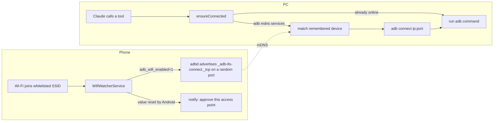

# adb-autolink documentation

Each document covers one topic.

| Doc | Covers |
|---|---|
| [architecture.md](architecture.md) | The components, the reconnect flow, and where state lives |
| [troubleshooting.md](troubleshooting.md) | Symptoms and fixes: discovery, approval, lock screen, install, battery |
| [release.md](release.md) | Version sync, building, and publishing a release |
| [../SECURITY.md](../SECURITY.md) | The security model and how to report a vulnerability |
| [../CHANGELOG.md](../CHANGELOG.md) | Release history |

