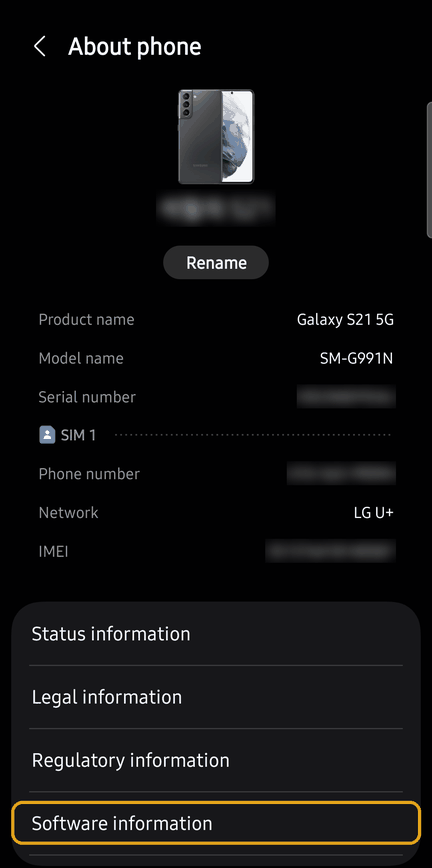
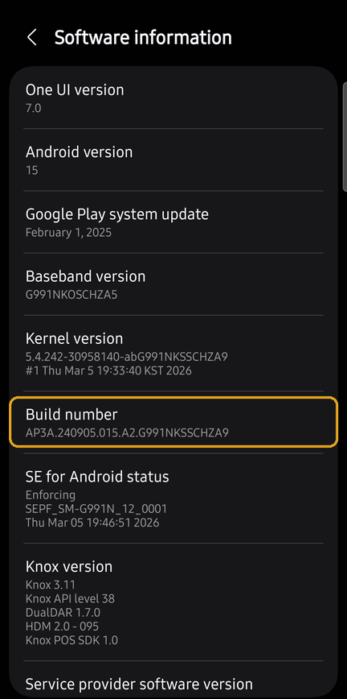
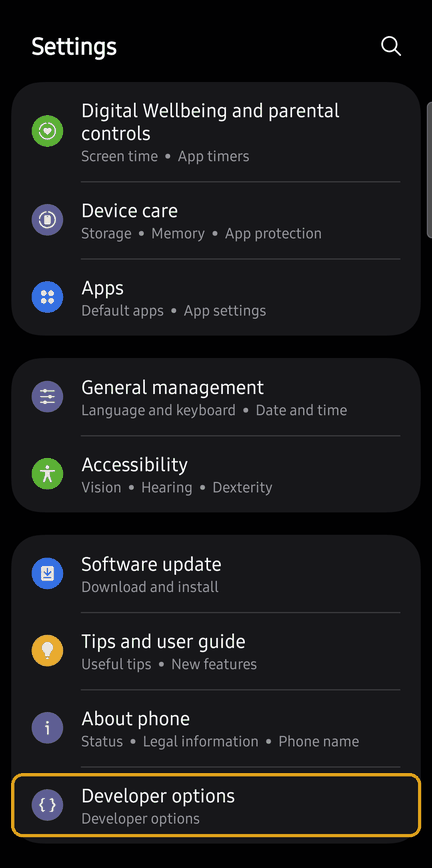
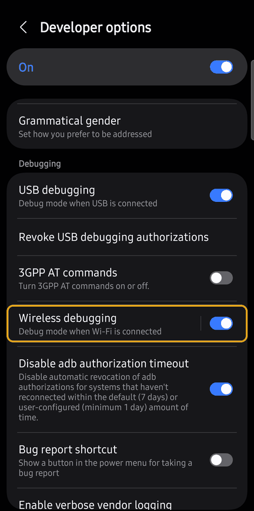
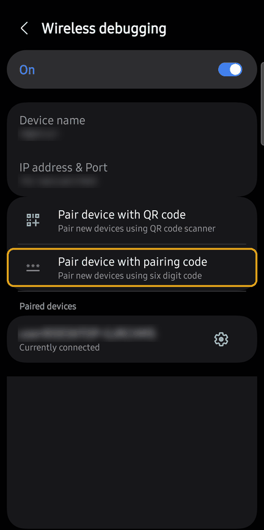
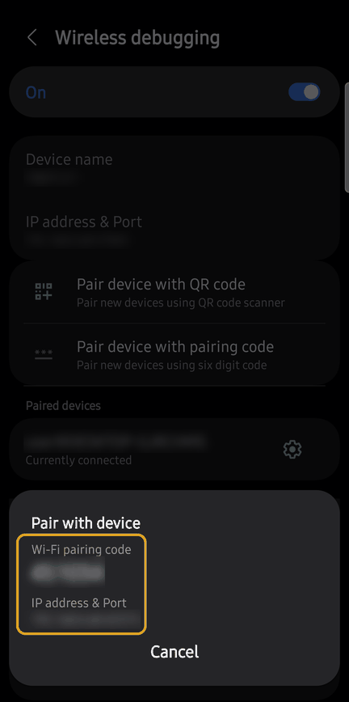

# Guide de configuration du débogage sans fil (Galaxy)

[English](wireless-debugging.md) · [한국어](wireless-debugging.ko.md) · [日本語](wireless-debugging.ja.md) · [简体中文](wireless-debugging.zh-Hans.md) · [Español](wireless-debugging.es.md) · **Français**

Pour que Claude sur votre PC se connecte au téléphone en Wi-Fi, effectuez ces étapes sur le téléphone **une seule fois**. Ensuite, l'application ADB Autolink active le débogage sans fil d'elle-même et Claude se connecte automatiquement.

- Captures : Galaxy S21, One UI 7 (Android 15). **Les captures sont en anglais** ; avec le téléphone en français, les menus sont au même endroit. D'autres modèles ou versions peuvent légèrement différer.
- Avant de commencer, **connectez le PC et le téléphone au même Wi-Fi**.

## 1. Activer les Options pour les développeurs

1. Ouvrez **Paramètres > À propos du téléphone > Informations sur le logiciel**.
2. Touchez **Numéro de version** 7 fois de suite. Saisissez le code PIN de verrouillage si demandé. Le message « Le mode Développeur a été activé » confirme l'opération.

## 2. Activer le débogage sans fil

1. Ouvrez **Options pour les développeurs**, désormais en bas des **Paramètres**.
2. Faites défiler jusqu'à **Débogage** et activez l'interrupteur **Débogage sans fil**.
3. À la question « Autoriser le débogage sans fil sur ce réseau ? », cochez **Toujours autoriser sur ce réseau** puis touchez **Autoriser**.

## 3. Associer le téléphone au PC (une fois par PC)

1. Touchez le texte **Débogage sans fil** (pas l'interrupteur) pour ouvrir son écran.
2. Touchez **Associer l'appareil avec un code d'association**.
3. Donnez à Claude le **code d'association Wi-Fi** (6 chiffres) et l'**adresse IP et port** affichés dans la boîte de dialogue. Par exemple : `associe 192.168.0.10:37099 123456`

- **Gardez la boîte de dialogue ouverte** jusqu'à la fin de l'association. Le code et le port changent à chaque ouverture.
- Le port de la boîte de dialogue est **différent** de « Adresse IP et port » en haut de l'écran Débogage sans fil. Utilisez celui de la boîte de dialogue.

## 4. Terminé

Une fois l'association faite, Claude installe l'application ADB Autolink et effectue tous les réglages. Ensuite, le débogage sans fil s'active dès que le téléphone rejoint un Wi-Fi autorisé, et Claude se connecte quand il en a besoin.

## En cas de problème

| Problème | Solution |
|---|---|
| Toucher Numéro de version ne fait rien | Les Options pour les développeurs sont peut-être déjà activées. Cherchez **Options pour les développeurs** en bas des Paramètres. |
| L'association échoue | Vérifiez que la boîte de dialogue est toujours ouverte, que le code et le port sont ceux affichés actuellement, et que le PC et le téléphone partagent le même Wi-Fi. |
| L'installation de l'application est bloquée | Désactivez **Paramètres > Sécurité et confidentialité > Blocage automatique** et vérifiez qu'aucune invite Play Protect n'est affichée. |
| Le téléphone est introuvable (Windows) | Réglez le profil du réseau Wi-Fi sur **Privé**. En Public, la détection du téléphone (mDNS) est bloquée. |
