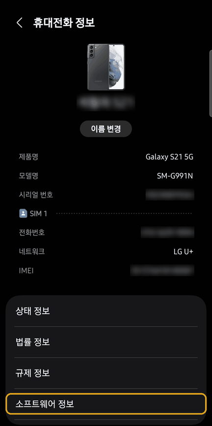
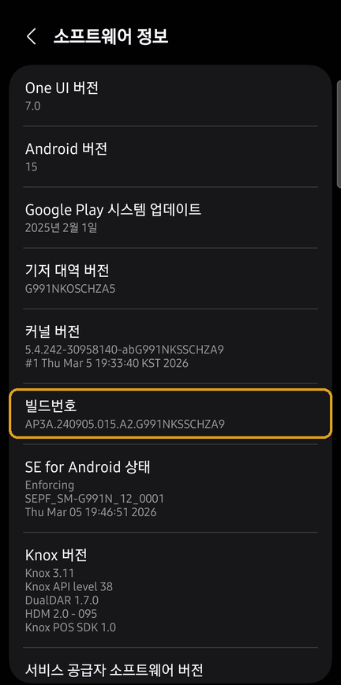
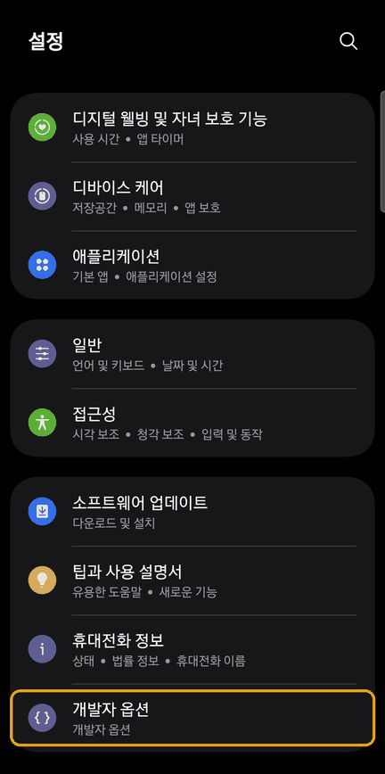
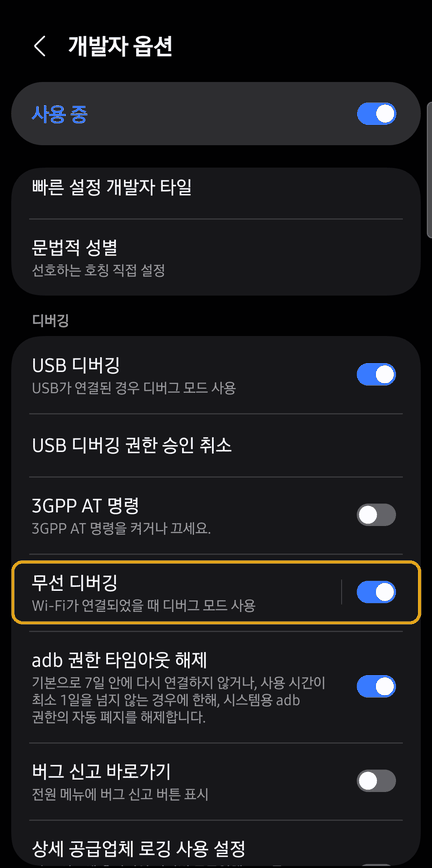
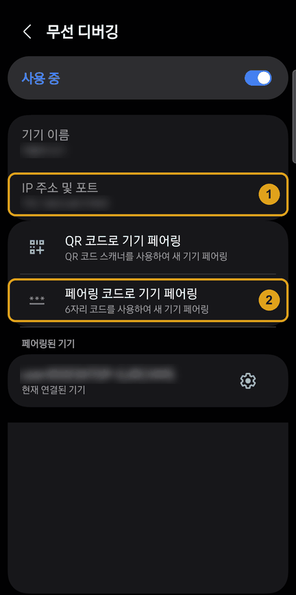
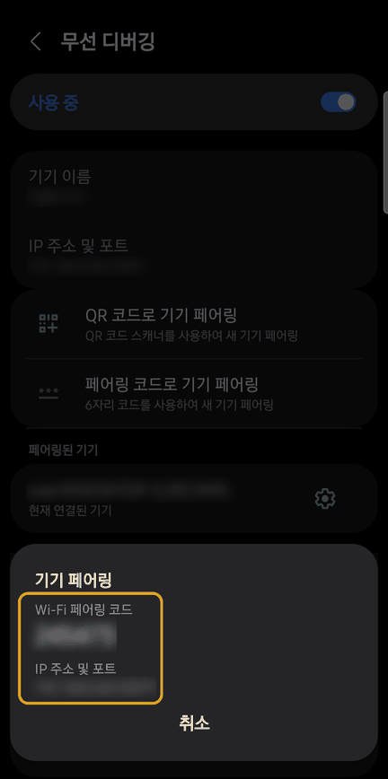

# 무선 디버깅 설정 가이드 (갤럭시)

[English](wireless-debugging.md) · **한국어** · [日本語](wireless-debugging.ja.md) · [简体中文](wireless-debugging.zh-Hans.md) · [Español](wireless-debugging.es.md) · [Français](wireless-debugging.fr.md)

PC의 Claude가 폰에 무선으로 연결하려면, 폰에서 **처음 한 번만** 아래 설정을 해야 합니다. 그다음부터는 ADB Autolink 앱이 무선 디버깅을 알아서 켜고, Claude가 알아서 연결합니다.

- 화면 기준: Galaxy S21, One UI 7 (Android 15). 다른 기종이나 버전은 메뉴 위치가 조금 다를 수 있습니다.
- 시작 전에 **PC와 폰을 같은 Wi-Fi에 연결**하세요.

## 1. 개발자 옵션 켜기

1. **설정 > 휴대전화 정보 > 소프트웨어 정보**로 들어갑니다.
2. **빌드번호**를 7번 연달아 누릅니다. 잠금 화면 PIN을 물으면 입력하세요. "개발자 모드를 켰습니다"라고 나오면 완료입니다.

## 2. 무선 디버깅 켜기

1. **설정** 맨 아래에 새로 생긴 **개발자 옵션**으로 들어갑니다.
2. 아래로 내려 **디버깅** 항목의 **무선 디버깅** 스위치를 켭니다.
3. "이 네트워크에서 무선 디버깅을 허용하시겠습니까?"라고 물으면 **이 네트워크에서 항상 허용**을 체크하고 **허용**을 누릅니다.

## 3. PC와 페어링하기 (PC마다 한 번)

1. 스위치가 아니라 **무선 디버깅** 글자를 눌러 상세 화면으로 들어갑니다.
2. ① 화면 위쪽의 **IP 주소 및 포트**를 확인합니다. Claude가 폰에 **연결할 때** 쓰는 주소입니다.
3. ② **페어링 코드로 기기 페어링**을 누릅니다.
4. 창에 나온 **Wi-Fi 페어링 코드**(6자리)와 **IP 주소 및 포트**(페어링용)를 확인합니다.
5. **세 값을 한 번에** Claude에게 알려 줍니다. 예: `연결 192.168.0.10:41235 / 페어링 192.168.0.10:37099 123456`

- 연결용(①)과 페어링용(창) 포트는 서로 **다릅니다.** 연결용 주소가 없으면 페어링은 되어도 연결이 안 될 수 있습니다. 창이 열린 뒤에도 ①은 창 뒤에 흐리게 보입니다.
- 페어링이 끝날 때까지 **창을 닫지 마세요.** 코드와 페어링용 포트는 창을 열 때마다 바뀝니다.

## 4. 끝

페어링되면 Claude가 ADB Autolink 앱을 설치하고 필요한 설정을 모두 마칩니다. 이후에는 허용된 Wi-Fi에 연결될 때마다 무선 디버깅이 자동으로 켜지고, Claude가 필요할 때 알아서 연결합니다.

## 잘 안 될 때

| 증상 | 해결 |
|---|---|
| 빌드번호를 눌러도 아무 반응이 없음 | 이미 개발자 옵션이 켜져 있을 수 있습니다. 설정 맨 아래에 **개발자 옵션**이 있는지 확인하세요. |
| 페어링 실패 | 창이 열려 있는지, 코드와 포트가 창에 나온 최신 값인지, PC와 폰이 같은 Wi-Fi인지 확인하세요. |
| 앱 설치가 막힘 | **설정 > 보안 및 개인정보 보호 > 자동 차단**을 끄고, 화면에 Play 프로텍트 확인 창이 떠 있는지 보세요. |
| 페어링은 됐는데 연결이 안 됨 | 무선 디버깅 화면 맨 위 **IP 주소 및 포트**(①)를 Claude에게 알려 주세요. 그 주소로 바로 연결합니다. |
| 폰을 찾지 못함 (Windows) | Wi-Fi 네트워크 프로필을 **개인**으로 설정하세요. 공용이면 폰 검색(mDNS)이 막힙니다. |
